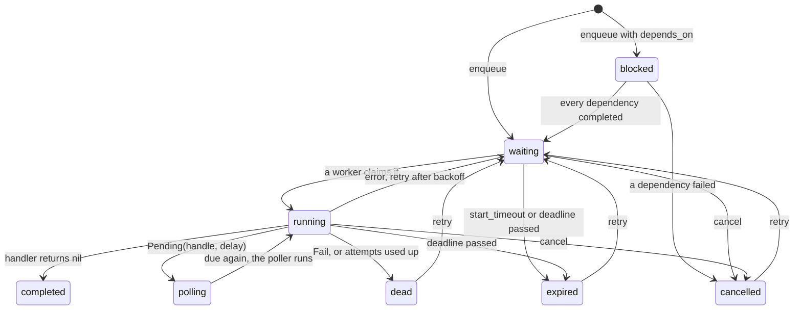

# Concepts

This page explains the ideas Runnel is built on. The exact rules, each with an id and the tests that check it, are in [SPEC.md](SPEC.md); this page links to them where it helps.

## Jobs

A job is one piece of work. It has:

- a `queue`, where it waits;
- a `kind`, which tells the worker which handler runs it;
- a JSON `payload`, the handler's input, up to 1 MiB by default;
- options: priority, group, pool, attempts, timeouts, a deadline, a unique key, dependencies, a callback URL and `meta` labels.

Each job gets an id that sorts by time. Runnel keeps the job until it ends and some time after: completed jobs for 24 hours, dead ones for 7 days, by default.

## Job states

`completed`, `dead`, `cancelled` and `expired` are final. Each final state writes an event, which is what callbacks and the `/events` feed send on. An operator can `retry` a dead, cancelled or expired job: it starts again from attempt one and keeps its error history.

## Queues

A queue is where jobs wait, and it holds limits for them. A queue needs no setting to exist; settings add limits:

| Setting | What it does |
|---|---|
| `max_running` | at most this many of its jobs run at once, across all workers |
| `group_max_running` | at most this many per group |
| `max_queued`, `group_max_queued` | refuse new jobs past this many waiting, with `429` |
| `rate`, `burst` | start at most `rate` jobs a second, with bursts up to `burst` |
| `group_rate`, `group_burst` | the same, per group |
| `paused` | no new job starts; running jobs finish |
| `max_attempts`, `backoff` | defaults for jobs that set none |
| `timeout`, `start_timeout`, `ttl`, `wait` | defaults for jobs that set none |
| `retention`, `dead_retention` | how long finished jobs are kept |
| `callback_url` | the callback of every job in it that sets none |

Every limit holds across every worker, because Runnel checks it when a job is claimed.

## Pools

A pool is a number of `slots` shared by every job that names it, whatever its queue. Use one for anything with a fixed capacity: one provider account, one GPU machine, one database. A pool can also cap each group (`group_slots`), limit starts per second (`rate`, `burst`), and pause, for good (`paused`) or until a time (`paused_until`). While a pool is paused, its jobs wait and every other pool keeps going.

## Groups

A group is any id you give a job, like a customer or an API key. Runnel knows nothing about it except the caps you set: `group_max_running` and `group_max_queued` on the queue, `group_slots` on a pool. A group at its cap is skipped when claiming, and the jobs behind it still run. That is how one busy customer cannot block the others.

## Picking the next job

When a worker claims, Runnel picks waiting jobs by priority (higher first, from -1000 to 1000), then by run time (older first). It skips jobs whose queue, group or pool is at a limit or paused. Polling jobs that are due are taken first.

## Workers, leases and heartbeats

A worker is your process. It has slots of its own (`Concurrency`), claims as many jobs as it has free slots, and runs one per slot. Runnel does not start, count or scale workers; your app decides how many run.

A claim takes a job under a lease: 30 seconds by default. The worker renews it with heartbeats every third of the lease. If a worker dies, its leases run out, and the maintainer puts its jobs back to waiting with one attempt used. If a job is cancelled or expires while running, the next heartbeat tells the worker, and the handler's context ends.

A worker stopped with a shutdown waits for running jobs, then gives the rest back without using an attempt.

## How a job ends

What the handler returns decides what happens next:

| Handler returns | What happens |
|---|---|
| `nil` | completed, with the result from `j.SetResult` |
| any error | retried after backoff; dead when attempts run out |
| `Fail(err)` | dead now, no retries |
| `RetryIn(d, err)` | retried after exactly `d` |
| `Busy(d)` | tried again after `d`, without using an attempt |
| `Pending(handle, d)` | polling: the outside task runs, and the poller checks `handle` after `d` |

Over HTTP the worker sends the same outcomes as `done`, `retry`, `fail`, `busy` and `pending`, plus `release`, which gives a job back untouched, as a shutdown does.

## Retries and backoff

A job has `max_attempts`: its own, else its queue's, else 5. After a failed attempt it waits `base * factor^(attempt-1)`, capped at `max`, give or take `jitter`, then runs again. The defaults are 1s, 2, 10m and 20%. Every attempt's error is kept, up to the last 20.

## Time limits

| Limit | Ends the job when | Result |
|---|---|---|
| `timeout` | one attempt runs longer than this | the attempt fails and is retried |
| `start_timeout` | the job waited this long without starting | `expired` |
| `deadline` or `ttl` | the job is not done by then, whatever it is doing | `expired`, and a running handler's context ends with `ErrDeadline` |

Runnel measures time on the store's clock, so servers with skewed clocks agree. Remote workers use the server's clock.

## Async work

Some work runs in an outside system, like a video render. The handler starts it and returns `Pending(handle, d)`. The job keeps its slot while it polls, so limits match what really runs. The poller checks the handle and returns `Pending` again, a result, or an error. See [async work](guides/async-work.md).

## Workflows

A job can depend on others (`depends_on`). It stays `blocked` until all of them complete, and it can read their results. If one fails, it and everything after it is cancelled. A flow enqueues a whole chain or DAG in one call. See [pipelines](guides/pipelines.md).

## Unique jobs

A unique key keeps one job per key: while the job runs, or for a time window. A second enqueue with the same key returns the first job, marked as a duplicate. See [safe re-enqueue](guides/safe-reenqueue.md).

## Schedules

A schedule enqueues a job on a cron spec (`0 3 * * *`, `@every 10m`, `@daily`), in a time zone. Each firing happens once, however many maintainers run. With `overlap: skip`, a firing is dropped while the schedule's last job is still waiting or running.

## Callbacks and events

When a job ends, Runnel can post its summary to a URL: the job's `callback_url`, or its queue's. The post is signed with HMAC-SHA256 under the namespace's secret, retried with backoff, and never sent to private addresses unless allowed. Events are also readable in order from `/v1/ns/{ns}/events`. See [callbacks](guides/callbacks.md).

## Namespaces and keys

A namespace is one service's separate set of queues, jobs, settings, callback secret and API keys. Keys belong to one namespace and carry roles:

| Role | Can |
|---|---|
| `producer` | enqueue jobs and flows, cancel jobs |
| `reader` | read jobs, stats and events |
| `worker` | claim, extend and finish jobs, read dependencies |
| `admin` | everything above, change settings, retry jobs |

The server's admin token, or a client certificate signed by its CA, manages namespaces and keys. Keys are stored only as SHA-256 hashes and shown once.

## Stores

Runnel keeps its data in a store: Postgres, MySQL, SQLite, Redis, Valkey, Dragonfly, or its own hybrid store on a local disk. Every store follows the same rules and passes the same tests. [Stores](stores.md) helps you pick one.
